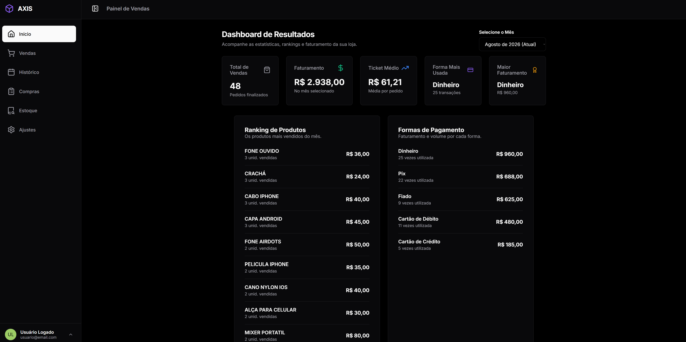

<div align="center">

# ⚡ AXIS — Sistema Integrado de Gestão & PDV Inteligente

**O centro de comando definitivo para o varejo moderno: controle de vendas, estoque em tempo real, relatórios gerenciais e notificações instantâneas no celular.**

[](https://github.com)
[](LICENSE)
[](https://firebase.google.com/)
[](https://github.com)
[](https://github.com)

<br>



<br>
<br>

[Acessar Demonstração](#-como-executar-o-projeto) • [Funcionalidades](#-funcionalidades-principais) • [Notificações Mobile](#-notificações-em-tempo-real-no-celular) • [Instalação](#-instalação-e-configuração) • [Tecnologias](#-tecnologias-utilizadas)

</div>

---

## 📖 Sobre o Projeto

O **Axis** é uma solução **SaaS (Software as a Service) / PDV** desenvolvida para simplificar e revolucionar a gestão de pequenas e médias empresas do varejo. Com foco obsessivo em **velocidade, usabilidade e design contemporâneo**, o sistema elimina burocracias de ERPs pesados e entrega uma experiência fluida para registrar transações, controlar inventário, emitir comprovantes e receber alertas de vendas na palma da mão em tempo real.

O sistema funciona tanto como **Aplicação Web responsiva (Mobile/Tablet/Desktop)** quanto como **Aplicativo Nativo Desktop para Windows** com instalador dedicado.

---

## 🌟 Diferenciais do Sistema

- ⚡ **Velocidade Milissegunda**: Interface construída para operar de forma instantânea sem gargalos no atendimento do caixa.
- 📶 **Suporte Offline First**: Graças à persistência do *Firebase IndexedDB*, falhas temporárias de conexão não travam a operação local.
- 📲 **Sincronização Push Mobile**: Notificação no smartphone do gestor a cada venda aprovada sem custos de infraestrutura de SMS ou WhatsApp.
- 🧾 **Impressão de Recibos Térmicos**: Compatível nativamente com impressoras não-fiscais térmicas de **58mm e 80mm**.
- 📊 **Cálculo Real de Rentabilidade**: Margens de lucro já descontando as taxas reais de cartões de débito e crédito.
- 📂 **Exportação e Backup**: Backup de produtos em formato CSV e importação de históricos legados em planilhas Excel (`.xlsx`).

---

## 🚀 Funcionalidades Principais

### 🛒 1. Frente de Caixa & PDV (Ponto de Venda)
- **Carrinho Dinâmico**: Adição rápida de itens com pesquisa preditiva (*autocomplete* de produtos cadastrados).
- **Múltiplos Meios de Pagamento**:
  - Dinheiro
  - Pix
  - Cartão de Débito
  - Cartão de Crédito (com parcelamento configurável de 1x até 12x e aplicação em conjunto)
  - Fiado (com registro de adiantamento / sinal de entrada)
  - **Pagamento Múltiplo / Dividido**: Possibilidade de fracionar uma única compra em várias formas de pagamento com cálculo em tempo real de saldo restante.
- **Descontos Flexíveis**: Aplicação de abatimentos tanto em valor monetário (`R$`) quanto em percentual (`%`).
- **Modos de Exibição**: Alternância entre visualização em blocos (*grid cards* com imagem) e lista compacta.
- **Edição e Estorno**: Permissão para estornar ou modificar vendas registradas com validação de segurança.

---

### 📦 2. Gestão Completa de Estoque & Produtos
- **Cadastro Completo**: Nome, foto do produto, quantidade em estoque, valor de custo e valor de venda.
- **Cálculo Automático de Lucro**:
  - Exibição em tempo real do **Lucro Líquido Real** (já descontando taxas de maquininha cadastradas).
  - Cálculo percentual da **Margem de Lucro Bruta**.
- **Badges e Tags Comerciais**: Destaque itens como `Mais Vendido`, `Em Promoção`, `Lançamento` ou `Esgotado`.
- **Filtros Avançados**:
  - Busca instantânea por nome.
  - Faixas de preço mínimo e máximo.
  - Faixas de quantidade mínima e máxima em estoque.
- **Ações em Lote (Bulk Actions)**: Seleção múltipla de produtos para exclusão em massa com verificação de segurança em dois níveis.
- **Backup & Restauração**:
  - Exportação completa do estoque para arquivo `.csv`.
  - Importação de backup para restauração rápida de dados.

---

### 📊 3. Dashboard Gerencial & Indicadores (BI)
- **Painel de Métricas (KPIs Mensais)**:
  - Faturamento Bruto total.
  - Quantidade de pedidos finalizados.
  - Ticket Médio por cliente.
  - Forma de pagamento mais utilizada (em volume de pedidos).
  - Forma de pagamento com maior volume financeiro arrecadado.
- **Rankings Analíticos**:
  - Ranking dos produtos mais vendidos no mês.
  - Distribuição percentual e financeira por meio de pagamento.
- **Histórico Completo de Vendas**:
  - Filtro por Vendas de Hoje, Dia Específico, Mês Selecionado ou ID da transação (`#ID`).
  - Ordenação por: Mais Recente, Mais Antigo, Maior Valor e Menor Valor.

---

### 📲 4. Notificações em Tempo Real no Celular
A cada nova venda concluída no PDV, o Axis envia automaticamente uma notificação push para o celular do administrador através da integração com o **ntfy.sh**.

- **Informações Notificadas**:
  - Valor total da transação.
  - Nome do estabelecimento.
  - Meios de pagamento utilizados (ex: *Pix*, *Crédito 3x*).
- **Sem Custos**: Utiliza o protocolo leve e livre do **ntfy**, disponível gratuitamente tanto para **Android** quanto para **iOS**.
- **Como Funciona**:
  1. Instale o app **ntfy** na [Google Play Store](https://play.google.com/store/apps/details?id=io.heckel.ntfy) ou [App Store](https://apps.apple.com/app/ntfy/id1625396347).
  2. Clique em **`+`** (Inscrever-se) e crie um nome de tópico exclusivo (ex: `minhaloja_vendas_xyz123`).
  3. No Axis, abra **Ajustes > Vendas e PDV** e cole esse mesmo nome de tópico.
  4. Pronto! Cada nova venda registrará um push imediato no seu celular com som e prévia.

---

### 🖨️ 5. Impressão Térmica e Geração de Documentos
- **Impressão Térmica Não-Fiscal**:
  - Layout otimizado para bobinas térmicas de **58mm** ou **80mm**.
  - Detalhamento de itens, valores unitários, quantidades, descontos, meio de pagamento e parcelas.
  - Cabeçalho personalizado com Nome Fantasia, CNPJ/CPF e Endereço configuráveis nos Ajustes.
- **Relatórios & Orçamentos em PDF**: Integração com **jsPDF** para emissão de orçamentos e relatórios contendo o logotipo personalizado da loja.
- **Migração do Excel**: Importador nativo de planilhas `.xlsx` / `.xls` via **SheetJS (xlsx)** para carregar relatórios e históricos legados.

---

### 🔒 6. Segurança e Perfis de Usuário
- **Autenticação Firebase**: Cadastro e login seguro por e-mail e senha com suporte à verificação de endereço por link de ativação.
- **Isolamento de Dados Multi-tenant**: Cada conta de lojista tem seu escopo isolado no banco de dados Firestore (`/artifacts/{appId}/users/{userId}/data`).
- **Chave de Proteção Administrativa**: Senha mestra requerida para ações sensíveis, como exclusão de produtos, alteração de alíquotas de maquininhas, edição de vendas passadas e restauração de dados.
- **Personalização de Perfil**: Foto de avatar customizada e nome de exibição do operador/vendedor.
- **Modos de Tema**: Suporte completo a **Dark Mode** (Tema Escuro monocromático moderno) e **Light Mode** (Tema Claro).

---

## 🛠️ Tecnologias Utilizadas

| Camada | Tecnologia | Descrição |
| :--- | :--- | :--- |
| **Frontend** | HTML5 Semântico, CSS3 Moderno, JavaScript (ES6+ Modules) | Aplicação ultra-rápida, sem dependência de frameworks pesados |
| **Backend & Cloud** | [Firebase Firestore](https://firebase.google.com/) | Banco de dados NoSQL em tempo real com suporte a consultas e snapshots |
| **Autenticação** | [Firebase Authentication](https://firebase.google.com/docs/auth) | Gerenciamento de credenciais, sessões e verificação de e-mails |
| **Cache Local** | IndexedDB Persistence | Sincronização offline e carregamento instantâneo de dados |
| **Notificações Push** | [ntfy.sh](https://ntfy.sh) | Protocolo HTTP Pub/Sub para push notifications no Android e iOS |
| **Documentos PDF** | [jsPDF](https://github.com/parallax/jsPDF) & AutoTable | Geração client-side de orçamentos e relatórios corporativos |
| **Manipulação Excel** | [SheetJS (xlsx)](https://sheetjs.com/) | Leitura e conversão de relatórios de vendas e planilhas legadas |
| **Ícones** | [Lucide Icons](https://lucide.dev/) | Pacote consistente e elegante de ícones vetoriais |
| **Seletor de Datas** | [Flatpickr](https://flatpickr.js.org/) | Calendário e seletor de períodos localizado em Português |
| **Desktop App** | Windows Executable Installer | Instalador `.exe` autônomo para terminais de caixa |

---

## 📂 Estrutura do Repositório

```plaintext
ju-magazine-axis/
├── index.html                   # Landing page moderna com animação 3D Tilt e partículas
├── README.md                    # Documentação oficial do projeto
├── mobile/                      # Aplicativo Mobile nativo em React Native + Expo (iOS / Android)
│   ├── App.js                   # Entry point, Splash screen e Providers
│   ├── package.json             # Dependências e scripts do React Native
│   └── src/                     # Telas, componentes Apple/shadcn, navegação e contextos
├── assets/
│   ├── img/
│   │   └── preview.png          # Captura da interface do dashboard
│   ├── scripts/
│   │   └── app.js               # Núcleo de lógica do PDV, Firestore, Ntfy e regras de negócio
│   └── styles/
│       └── style.css            # Estilização completa, variáveis de cor e responsividade
├── downloads/
│   └── Axis Setup.exe           # Instalador do aplicativo desktop para Windows
└── pages/
    ├── app.html                 # Aplicação principal (Dashboard, Caixa, Estoque, Ajustes)
    └── login.html               # Tela de autenticação (Login, Registro e Recuperação)
```

---

## ⚡ Como Executar o Projeto

Como o sistema é construído sobre módulos nativos do **JavaScript (ES Modules)** e integra-se diretamente ao Firebase via CDN, você pode rodá-lo utilizando qualquer servidor web local.

### Pré-requisitos
- Um navegador moderno (Google Chrome, Edge, Firefox, Brave, Safari).
- Uma extensão de servidor estático (como o **Live Server** no VS Code) ou utilitários via terminal:
  - **Python**: `python -m http.server 8000`
  - **Node.js**: `npx serve` ou `npx http-server`

### Passo a Passo

1. **Clone o repositório:**
   ```bash
   git clone https://github.com/seu-usuario/axis-pdv.git
   cd axis-pdv
   ```

2. **Inicie o servidor estático:**
   *Com Node.js:*
   ```bash
   npx serve .
   ```
   *Com Python:*
   ```bash
   python -m http.server 3000
   ```

3. **Acesse no navegador:**
   - Landing Page: `http://localhost:3000/index.html`
   - Painel do Sistema: `http://localhost:3000/pages/app.html`
   - Tela de Login: `http://localhost:3000/pages/login.html`

---

## ⚙️ Configuração do Firebase

Caso deseje apontar o sistema para a sua própria instância do Firebase:

1. Acesse o [Console do Firebase](https://console.firebase.google.com/) e crie um novo projeto.
2. Ative os serviços:
   - **Authentication** (habilite o provedor *E-mail/Senha*).
   - **Cloud Firestore** (crie um banco no modo de produção ou teste).
3. Copie as credenciais da sua Web App e substitua no início dos arquivos:
   - `assets/scripts/app.js` (linha ~14)
   - `pages/login.html` (linha ~179)

```javascript
const firebaseConfig = {
    apiKey: "SUA_API_KEY",
    authDomain: "seu-projeto.firebaseapp.com",
    projectId: "seu-projeto",
    storageBucket: "seu-projeto.firebasestorage.app",
    messagingSenderId: "SEU_MESSAGING_ID",
    appId: "SEU_APP_ID"
};
```

---

## 💻 Versão Desktop (Windows)

Para lojistas que preferem operar o PDV em computadores de balcão sem abrir abas de navegadores:
- O instalador oficial já se encontra empacotado na pasta `downloads/`:
  - **Arquivo**: `downloads/Axis Setup.exe`
- Basta executar o instalador para ter o atalho do Axis na Área de Trabalho e no Menu Iniciar.

---

## 🎯 Roadmap & Próximas Atualizações

- [ ] Emissão de Cupom Fiscal Eletrônico (NFC-e / SAT).
- [ ] Integração direta com gateways de pagamento TEF e maquininhas SmartPOS.
- [ ] Módulo avançado de controle de fluxo de caixa (Sangria e Suprimento de Gaveta).
- [ ] App mobile nativo com câmera atuando como leitor de código de barras.

---

## 📄 Licença

Este projeto está distribuído sob a licença **MIT**. Consulte o arquivo [LICENSE](LICENSE) para obter mais informações.

---

<div align="center">
  <sub>Desenvolvido com foco em alta performance e design para o varejo.</sub>
</div>
